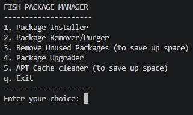

# fish-package-manager
A package manager writed in fish.

## Installing Fish
```bash
sudo apt install fish
```

## First use:

```bash
chmod +x fish-package-manager.fish
```

Execution:
```bash
./fish-package-manager.fish
```
## Usage:

First, the script updates the apt package list.\
(It will ask for a sudo password)

Afterwards, this menu will appear:



Enter a single number here. The number of your chosen option or q to exit.

## 1. Package installer:

Search for a package, find the one you need in the list, and enter its number. The details for the selected package will then appear, and you will be asked do you want to install it.

## 2. Package Remover/Purger

Search for a package, locate the one you need in the list, and enter its number. You will then be asked whether you want a complete removal (deleting configuration files as well "purge") or a standard removal, which deletes only the program while leaving the configuration files untouched.

## 3. Remove Unused Packages

This will remove dependency packages that are no longer in use (e.g., they belonged to a package that has already been deleted). (This frees up space.)

## 4. Package Upgrader

You can use this to upgrade the entire system, or just a selected package.

## APT Cache cleaner

This deletes files in the apt cache—for example, .deb files. It saves space. It does not delete packages.

## Information:

The program runs on a Debian-based system and uses the apt package manager. apt must be installed.